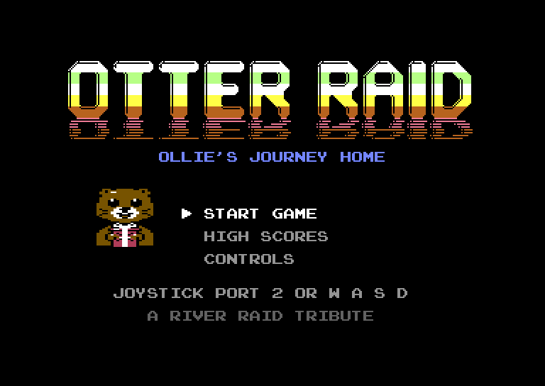
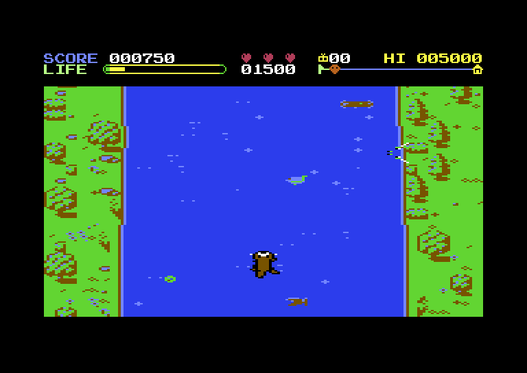
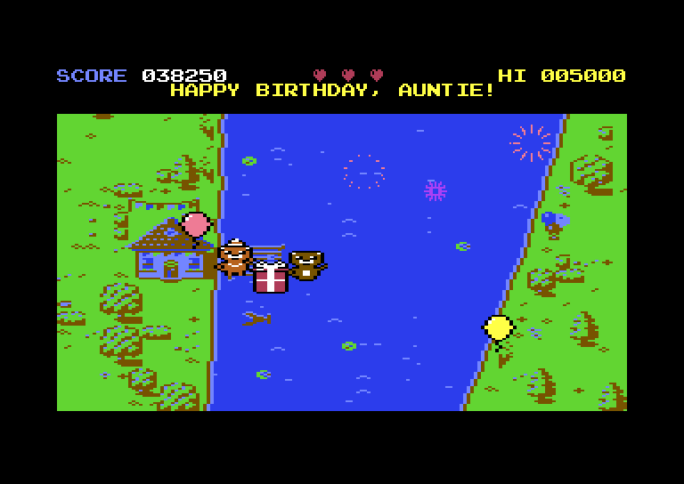

<h1 align="center">Otter Raid — A River Raid-Inspired C64 Game with Otters</h1>

Otter Raid is a Commodore 64 action game inspired by <i>River Raid</i>, with a decidedly more aquatic hero.

You are **Ollie Otter**, swimming upstream to get home for Auntie's birthday party. Friends and family are waiting, and Ollie has a present to deliver. Unfortunately, the river is full of alligators, and an eagle periodically swoops down looking for a meal.

The goal is not to survive forever. **Get Ollie home.**

## Screenshots

| Title | On the river | Home at last |
|:---:|:---:|:---:|
|  |  |  |

## Game Flow

1. Start at the bottom of the river with **1,000 Life Points and 3 hearts**.
2. Swim upstream while managing speed and position.
3. Avoid alligators coming from either river bank.
4. Dive underwater to avoid alligators and the eagle.
5. Collect crawfish for **5 seconds of invulnerability**, fish to restore Life Points, and rare gifts for Auntie.
6. Recover Life Points through safe upstream progress.
7. Reach the end of the river.
8. Celebrate with Auntie, Ollie, and the birthday present.
9. See the score/high-score flow and play again.

If Ollie runs out of Life Points, a heart is lost and the run resets. An eagle catch also costs a heart and resets the run. Lose all three hearts and it's Game Over.

After losing a heart, Ollie can earn it back by earning **5,000 Life Points** since that loss, up to three hearts.

## Controls

| Key | Action |
| --- | --- |
| W | Swim faster / upstream |
| A | Move left |
| S | Slow down |
| D | Move right |
| SPACE | Dive |
| P | Pause / resume |
| RETURN | Select in menus |

A joystick in **port 2** works the same way (up = faster, down = slower, fire = dive). Keyboard and joystick can be mixed.

## Gameplay Systems

### Life Points

- Start: **1,000**
- Maximum: **10,000**
- Recover through safe upstream progress: **+5 per river row** once Ollie has gone 16 rows without a bite
- Alligator damage is **100 points**
- Diving longer than 3 seconds costs **50 points/second**
- Life Points are separate from score

### Hearts

Ollie starts with **3 hearts**.

A heart is lost when:
- Life Points reach zero
- The eagle catches Ollie

Losing a heart resets the current river run while preserving the overall score. If all three hearts are lost, the game goes to Game Over.

A recovered heart is earned after **5,000 newly accumulated Life Points** following a heart loss, up to the maximum of three hearts.

### Diving

Ollie can dive underwater for free for **3 seconds**.

While diving:
- Alligators cannot hurt Ollie.
- The eagle cannot catch Ollie.

Staying underwater longer costs **50 Life Points per second**.

Diving protection and crawfish protection are independent. If both are active, Ollie remains protected until both protections have ended.

### Alligators

Alligators enter from the river banks and cross the river at varying speeds.

Each alligator is an independent world object with its own position, side, direction, speed, and movement state. Alligators can occupy different river rows, including facing one another from opposite banks, without interacting or colliding with each other.

The rewrite uses a fixed pool of independent alligator objects rather than fixed patrol patterns, with **4 active alligators supported initially**. Alligators do not collide with one another.

### Eagle

Every roughly **90–120 seconds**, an eagle screeches and its shadow slides in from a randomly selected side. It then swoops down in a V from that top corner toward the spot where Ollie was, and climbs out on the opposite side.

If it misses Ollie, it keeps going rather than turning around for another attack, and Ollie earns 1,000 points. If it catches him, it carries him off and a heart is lost.

Diving or crawfish protection prevents the eagle from catching Ollie.

The eagle's attack timer resets when a run resets.

### Crawfish

Crawfish appear as part of the generated river environment.

Catching a crawfish gives Ollie **5 seconds of invulnerability** against both alligators and the eagle.

Crawfish are not guaranteed to be safely reachable. A player may have to decide whether pursuing one is worth the positioning and hazard risk.

### Fish

Plump little fish float in the river too. Eating one restores **250 Life Points** (and counts toward earning back a lost heart).

### Gifts for Auntie

Now and then a rare present floats by: a water-lily blossom, a slice of birthday cake or a wrapped gift box. Each is worth 1,000 points and is counted in the HUD. At the homecoming Auntie unwraps every gift Ollie collected for an extra 500 points each.

### River

The river scrolls downward to create the illusion of swimming upstream.

The river is generated in **40 smooth river sections** rather than jagged row-by-row randomness. Each section eases from the previous section's end into a bend, a straight, a width change or an island. The river narrows as the journey goes on. Only a few rows ahead of the screen are kept in RAM; the 40-section journey is a logical progression rather than 40 full sections stored at once.

The banks are dressed with trees, bushes, rocks, cottages, and reeds at the water's edge. The water has lily pads, rocks and floating logs, and Auntie's house waits at the end.

### Distance and Speed

Progress toward home is measured by **distance traveled upstream**, not simply elapsed time.

Swimming faster advances the journey faster but gives the player less time to maneuver and recover Life Points. Swimming slower advances the journey more slowly but gives the player more control and time.

There are three discrete swimming speeds, chosen by holding Up/W or Down/S: **slow, normal and fast** scroll the river at 1, 1.75 and 2.5 pixels per frame. At normal speed the journey takes a little under four minutes.

## State Machines

The rewrite uses explicit state machines so that the game's behavior remains predictable and manageable in 6502 assembly.

The main game states are:

- **TITLE**: the menu, with the high scores, controls and name entry as sub-screens; left idle, it tours the high scores and then plays an attract demo
- **PLAYING**: starts every run with a short GET READY pause
- **PAUSED**
- **LIFE_LOST**
- **GAME_OVER**
- **HOME**

While the main game is PLAYING, individual systems have their own state:

- Ollie has independent dive and crawfish-protection timers.
- Each alligator has its own movement state (lurk, swim, bite, sink).
- The eagle has an independent attack state machine (wait, warn, swoop, carry).
- Crawfish are part of the river graphics and are simply eaten.
- The river manages its current generated section and scroll position.

The full state-machine design is documented in **docs/c64-state-machine.md**.

## The Homecoming

Reaching the destination triggers a short celebration rather than simply ending the game.

The river stops at Auntie's house. Ollie swims to the dock, and Ollie, Auntie and the birthday present dance while balloons rise and fireworks burst. Leftover Life Points (100 points per 100 LP) and hearts (5,000 points each) are added to the score before the high-score flow.

## Development

The game is a **gameplay-engine rewrite** of the original monolithic assembly source (kept as `c64/otter_raid_c64.asm` for reference). The rewritten engine is implemented in `c64/` and provides:

- Explicit game states and transitions
- A documented C64 memory map (`c64/memory.asm` is the only place RAM is allocated)
- Separate player/input/river/enemy/eagle/HUD/menu modules
- Smooth procedural river generation with a double-buffered, raster-split vertical scroll
- A finite distance-based journey
- A complete start-to-home game loop with title, high scores and an attract demo

The docs below were written before the code and have been updated to match it; each one notes where the implementation changed the original design.

The detailed game design is in **docs/otter-raid-game-design.md**.

The C64 memory layout is in **docs/c64-memory-map.md**.

The state-machine design is in **docs/c64-state-machine.md**.

The frame/update contract is in **docs/c64-frame-update-flow.md**.

The river architecture is in **docs/c64-river-engine.md**.

The object/collision architecture is in **docs/c64-object-and-collision-system.md**.

Graphics and sound are described in **docs/c64-graphics.md** and **docs/c64-sound.md**.

The implementation work is tracked in the GitHub issue for the gameplay-engine rewrite.

## Current Platform

- Commodore 64/128 (in 64 mode)

### Planned

- Commander X16

## Building

The build uses VASM (`vasm6502_oldstyle`).

    make            # build/otter_raid.prg (+ build/otter_raid.lst listing)
    make run        # build and launch in VICE (x64sc)
    make assets     # regenerate graphics data from gfx/ (python3)
    make clean

The PRG loads at `$0801` and starts itself with `SYS 2061`. `tools/vicetest.py` drives VICE headlessly (Xvfb plus the remote monitor) for automated checks: breakpoints, screenshots, memory reads and an input-override hook. See **docs/c64-build.md** for the complete workflow.

